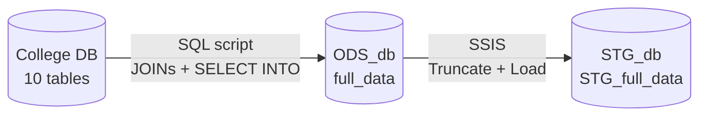
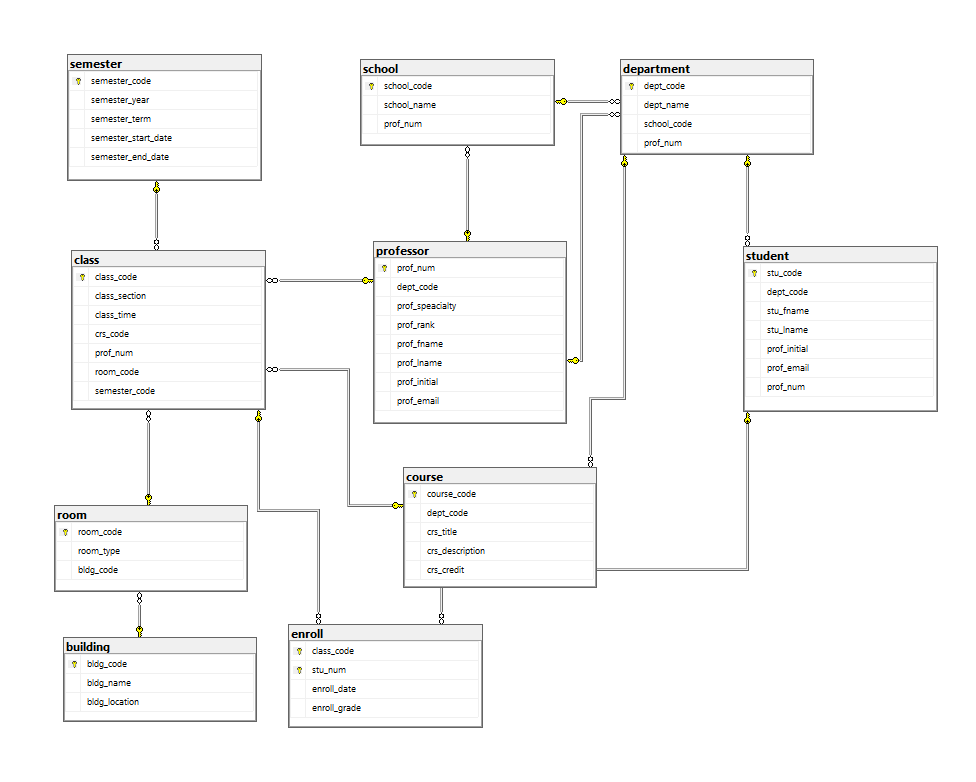
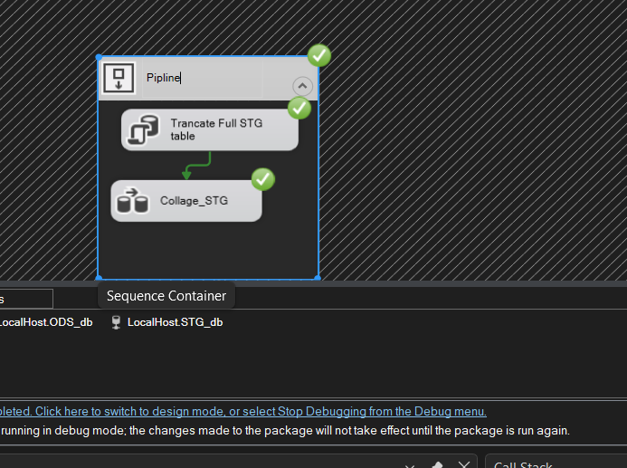
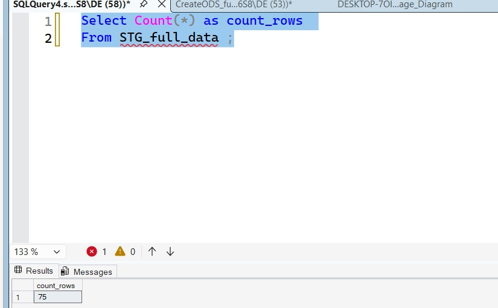

# College Database & SSIS ETL Pipeline

An end-to-end learning project from my NTI DataOps Engineer training: a relational college database, an ERD, an ODS layer built with SQL, and an SSIS ETL pipeline that loads the data into a Staging database.

## Architecture



## ERD



## Source Database (`College`)

10 tables: `professor`, `school`, `department`, `semester`, `course`, `student`, `building`, `room`, `class`, `enroll`.

Design highlights:
- Primary keys on every table and foreign keys enforcing referential integrity
- `enroll` is a junction table (composite PK: `class_code` + `stu_num`) resolving the many-to-many relationship between students and classes
- `CHECK` constraints validating email format
- `NOT NULL` constraints and appropriate data types (`date`, `time`, `varchar`, `text`)
- Foreign keys on `enroll` added with `ALTER TABLE` after table creation
- Sample data loaded in dependency order: 12 professors, 3 schools, 6 departments, 5 semesters, 18 courses, 40 students, 4 buildings, 12 rooms, 24 classes and 75 enrollments, followed by a row-count verification query

## ODS Layer (`ODS_db`)

`sql/03_create_ods_full_data.sql` builds a single denormalized table, `full_data`, with `SELECT ... INTO` and `LEFT JOIN`s across 9 tables.

- **Grain:** one row per student enrollment in a class
- `LEFT JOIN` keeps every enrollment even if a related record is missing

## Staging Layer (`STG_db`)

`STG_full_data` has the same structure as `full_data`. The SSIS package reloads it on every run.

## SSIS Package

Inside a Sequence Container:

1. **Execute SQL Task**: truncates `STG_full_data`
2. **Data Flow Task**: loads `ODS_db.full_data` into `STG_db.STG_full_data`

The tasks are linked by a success precedence constraint, and the package uses connection managers for `ODS_db` and `STG_db`. Truncate-and-load makes the run repeatable: running it again never creates duplicates.



## Result



## How to Run

Requirements: SQL Server, SSMS, Visual Studio with the SSIS extension.

1. Run `sql/01_create_college_db.sql`, then `sql/02_insert_data.sql`
2. Run `sql/00_create_ods_stg.sql` to create `ODS_db` and `STG_db`
3. Run `sql/03_create_ods_full_data.sql` to build `ODS_db.full_data` and the empty `STG_db.STG_full_data`
4. Open `ssis/Collage_ELT.slnx` in Visual Studio, point the `ODS_db` and `STG_db` connection managers at your server, and run the package
5. Run `sql/04_validation.sql`. The three row counts should match (75 with the sample data)

## Repository Structure

```
.
├── sql/
│   ├── 00_create_ods_stg.sql
│   ├── 01_create_college_db.sql
│   ├── 02_insert_data.sql
│   ├── 03_create_ods_full_data.sql
│   └── 04_validation.sql
├── ssis/
├── docs/
└── README.md
```

## Design Notes

- The layer order in this project is **Source → ODS → Staging**, as taught in the training. Many data warehouse designs load raw copies into Staging first and build the ODS after it (Source → Staging → ODS → DWH), which is a natural next step.
- Staging is fully reloaded on each run (truncate and load). Incremental loading is not implemented yet.

## Tech Stack

SQL Server · SSMS · SSIS (Visual Studio) · T-SQL

## What I Learned

- Relational database design, normalization, and ERD modeling
- Keys and constraints (PK, FK, composite keys, CHECK)
- Resolving many-to-many relationships with a junction table
- Handling insert order and dependencies between tables
- Moving data from the source database to an ODS and then to Staging
- Denormalization, choosing a table grain, and LEFT vs. INNER JOIN trade-offs
- Building ETL in SSIS: Sequence Container, Execute SQL Task, Data Flow Task, precedence constraints, connection managers
- Truncate-and-load for repeatable runs
- Validating loads with SQL checks

## Next Steps

- Build the data warehouse layer (star schema with fact and dimension tables)
- Add incremental loading

## Acknowledgements

Thanks to my two instructors at NTI for their guidance and support.
